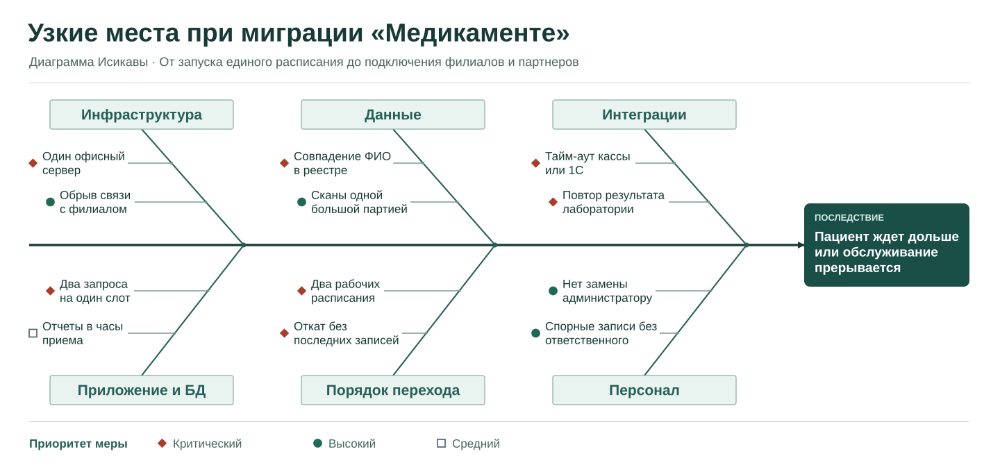

# Что может замедлить работу «Медикаменте» при миграции

Первым я перенес бы расписание. Если портал дважды подтвердит одно время, ошибку заметят у кабинета врача. Исторические сканы можно переносить постепенно, а фоновую загрузку можно прервать, когда она мешает приему. От этой разницы зависит порядок перехода.

## Какие процессы затрагивает переход

| Этап | Что меняется | От чего зависит работа клиники |
| --- | --- | --- |
| Сейчас | Ресепшен записывает пациентов в журналы Excel. Кассир отражает оплату в Excel и 1С. Лабораторный реестр, сканы, обе файловые базы 1С, Active Directory и Exchange размещены на одном офисном сервере Windows Server 2022. | Выгрузка большого архива может занять тот же диск, с которого бухгалтерия читает свою базу. Фактический запас производительности и пропускная способность сети пока неизвестны. |
| MVP, ориентир — два месяца | Портал пациента и рабочее место ресепшена бронируют время в одном приложении на Java с базой PostgreSQL. В пилот переношу будущие визиты выбранных врачей. Ресепшен пока сам напоминает о приеме пациенту и врачу. | Для каждого расписания нужно выбрать момент переключения. Пациент на сайте и сотрудник у стойки должны видеть один результат бронирования. |
| Целевое состояние, ориентир — год | Добавляются филиалы, мобильное приложение и уведомления. Платформа принимает результаты лаборатории, сверяет оплату с 1С и передает согласованные выгрузки через NiFi в озеро данных. Отдельная задача на Python готовит витрины для отчетов и публикует их в ClickHouse. | Задержка партнера или расчет отчета не должны останавливать запись. Бухгалтерия, кадровый учет и склад продолжают работать в своих базах 1С. |

Границы пилота и состав систем соответствуют предыдущим заданиям. [Данные и процессы клиники](../Task1/01-data-inventory.md) · [Архитектура MVP и целевой платформы](../Task2/README.md)

## Диаграмма Исикавы

Справа показано последствие для пациента. На каждой ветви я указал две возможные причины. Это гипотезы для проверки на пилоте. В описании клиники нет замеров, по которым уже можно было бы признать кассу, сервер или сеть узким местом. [Редактируемая диаграмма в draw.io](ishikawa.drawio)

Приоритет относится к мере на том этапе, когда включается соответствующая функция. **Критический** означает, что до устранения причины запускать этот поток нельзя — можно потерять подтвержденную операцию, выдать неверный результат или остановить прием. **Высокий** допускает короткую работу по согласованному запасному порядку. **Средний** означает, что работу можно отложить. Для отчетности это допустимо лишь пока соблюдается целевое время записи пациента.

## Причины, меры и приоритеты

| Ветвь и причина | Как проявится проблема | Что я предлагаю сделать и проверить | Приоритет и срок |
| --- | --- | --- | --- |
| Инфраструктура · **Один офисный сервер** | Во время чтения архива растет очередь дисковых запросов. Замедляются работа с журналом и проведение документов в 1С. Отказ узла затронет также вход сотрудников. | Разместить новую платформу отдельно от старого сервера. На репетиции запустить копирование при обычной нагрузке, сравнить задержку чтения и время проведения документа. Если домен и DNS зависят от одного узла, подготовить резервный контроллер на другом хосте. При остановке основного узла проверить вход сотрудников и открытие расписания. | Критический · до пилота |
| Инфраструктура · **Обрыв связи с филиалом** | На стойке пропал ответ после нажатия «Записать». Пациент уже мог получить подтверждение, а сотрудник попробует создать второй визит. | Присваивать заявке номер. После восстановления связи проверять ее статус по этому номеру. Пока расписание недоступно, ресепшен фиксирует просьбу и контакт для обратной связи, оставляя время неподтвержденным. На стенде оборвать связь после сохранения записи, затем сверить результат с обеих сторон. | Высокий · до первого филиала |
| Данные · **Совпадение ФИО в реестре** | При переносе двух однофамильцев можно объединить в одного пациента. Визит или заключение окажется в чужой карте, а разбор совпадений задержит открытие расписания. | Сохранить связь каждой исходной строки с ее номером в платформе. Спорные совпадения передать на сверку уполномоченному сотруднику. До открытия записи по выбранным врачам разобрать каждый спорный будущий визит. В пробной загрузке проверить двух пациентов с одинаковыми ФИО. | Критический · до переноса визитов |
| Данные · **Сканы одной большой партией** | Чтение крупных PDF и JPG забирает полосу и место на диске. После обрыва повтор всей загрузки удлиняет окно миграции. | Переносить небольшими партиями с ограничением скорости. Фиксировать исходный идентификатор, размер, контрольную сумму и последнюю завершенную партию. После обрыва продолжить с первой незавершенной партии. Сверить количество файлов и их контрольные суммы, открыть выборку под разрешенной ролью. | Высокий · до переноса архива |
| Интеграции · **Тайм-аут кассы или 1С** | ККМ могла уже пробить чек, когда адаптер перестал ждать ответ. Повтор команды создает риск второго чека, а очередь операций мешает закрытию смены. | С кассиром и администратором установить, где работает OLE-компонента и как проверить чек по реквизитам. После тайм-аута сохранить статус «требует сверки». На тестовой операции потерять ответ и сопоставить чек, сумму и запись в 1С. Для онлайн-оплаты так же сверить заказ со статусом провайдера до повторной обработки. | Критический · до переключения оплаты |
| Интеграции · **Повтор результата лаборатории** | После задержки лаборатория отправляет результат еще раз. Исправленная версия может прийти раньше исходной. Врач рискует увидеть дубль или устаревший результат. | Согласовать с лабораторией идентификатор результата и порядок версий. Подтверждать доставку после сохранения. При повторе проверять партнера, направление, идентификатор и версию. На стенде повторить доставку и поменять порядок версий. В карте должна остаться актуальная версия с историей изменений, спорное сообщение уходит на разбор. | Критический · до открытия API лаборатории |
| Приложение и БД · **Два запроса на один слот** | Портал и ресепшен почти одновременно видят свободное время. Длительная блокировка замедлит ответ, а раздельные проверки могут дать два подтверждения. | Провести оба канала через одну короткую транзакцию бронирования. В PostgreSQL разрешить одну активную бронь на слот врача. При одновременной записи проверить число подтверждений, ожидание блокировки и время ответа проигравшего запроса. | Критический · до пилота |
| Приложение и БД · **Отчеты в часы приема** | Подготовка витрин вынесена в аналитический контур, но массовая выгрузка из операционной базы все еще может надолго занять ее соединения и увеличить нагрузку на диски. | Ограничить одновременно работающие выгрузки, читать изменения порциями и переносить тяжелый пересчет на часы низкой нагрузки. Сравнить время бронирования при включенной и приостановленной выгрузке. Если прием замедлился, отложить отчет. | Средний · ограничение до запуска BI, подбор размера партий после пилота |
| Порядок перехода · **Два рабочих расписания** | Пациента записали по телефону в Excel, пока портал подтвердил то же время другому. В PostgreSQL обе операции никогда не встречались. | Назначить одно расписание для записи по каждому врачу и периоду. На переключении временно остановить изменения, перенести последнюю разницу и сверить будущие визиты. С открытия портала старые журналы доступны на чтение. На репетиции ресепшен должен найти, перенести и отменить запись с сайта. | Критический · в окно пилота |
| Порядок перехода · **Откат без последних записей** | Возврат к утренней копии уберет визиты, подтвержденные после открытия портала, и вернет отмененные. | Сохранять журнал подтвержденных изменений и проверять его доступность при отказе платформы. На репетиции добавить, перенести и отменить визиты после контрольной копии. После возврата сверить каждый номер, время и статус с журналом. | Критический · до пилота и каждой новой волны |
| Персонал · **Нет замены администратору** | В ИТ-отделе три человека с разными задачами. Если порядок восстановления знает только сетевой администратор, смена будет ждать, пока он освободится. | Техническому директору назначить технического заместителя, проверить его доступ к инструкции и аварийному комплекту. На репетиции заместитель сам восстанавливает доступ, а ресепшен подтверждает, что видит расписание своих врачей. Зафиксировать затраченное время. | Высокий · до пилота |
| Персонал · **Спорные записи без ответственного** | Очередь исключений растет даже при исправных серверах. Сотрудники видят отказ загрузки, но пациент продолжает ждать результата или подтверждения оплаты. | Закрепить разбор визитов за старшим смены ресепшена, чеков — за бухгалтером, результатов — за ответственным медспециалистом вместе с лабораторией. Отслеживать возраст самой старой заявки. При передаче смены проверять, кто принял открытые случаи. | Высокий · до подключения каждого потока |

Для кассы и лаборатории важно заранее договориться, как отличить повтор от новой операции. Уникальный номер и результат обработки нужно фиксировать согласованно, чтобы сбой между двумя записями не привел к повторному действию. [Повторяемые запросы с идентификатором операции](https://aws.amazon.com/builders-library/making-retries-safe-with-idempotent-APIs/) · [Ограничения уникальности в PostgreSQL](https://www.postgresql.org/docs/current/ddl-constraints.html#DDL-CONSTRAINTS-UNIQUE-CONSTRAINTS)

## Как принять решение о запуске

1. **Снять исходные показатели.** За обычную рабочую неделю ресепшен отмечает число записей за самые загруженные 15 минут и время оформления на стойке. Бухгалтер фиксирует время проведения документа при одновременной работе кассы и склада. Администратор измеряет занятый объем, скорость чтения сканов и задержку диска в те же часы. Это даст профиль для стенда и позволит отличить проблему миграции от уже существующей задержки.
2. **Проверить требуемый рост.** На тестовых данных сравнить текущий и пятикратный объемы истории, сохранив доли визитов и размеры документов. Сначала воспроизвести один и тот же измеренный пик запросов, затем отдельно увеличивать число одновременных обращений до нарушения цели. Так видно, что ограничило систему — размер базы или конкуренция за ресурс. Время переноса архива оцениваю по объему и измеренной скорости от чтения до проверки копии. В окно также должны поместиться сверка и повтор прерванной партии.
3. **Согласовать критерии приемки.** Для пилота я предлагаю ориентир — в течение 30 минут расчетного пика 95 % ответов на бронирование приходят не позднее чем за 2 секунды, доля технических ошибок ниже 1 %. Замер идет от отправки заявки до ответа о записи. Ответ «время занято» учитываю отдельно. Если одновременно подать 20 разных заявок на один свободный слот, должно получиться ровно одно подтверждение. Для оплаты требую совпадения количества чеков и суммы за смену, для лаборатории — отсутствия потерянных принятых сообщений и результатов в чужих картах. Для очередей отдельная проба — после десятиминутного перерыва обмена при продолжающемся потоке предлагаю дать 20 минут на возврат к исходному размеру очереди. Отдельно проверю возраст старейшего сообщения, чтобы не пропустить зависшую операцию. Все сроки здесь предложены для испытаний. Замеров рабочей платформы пока нет.
4. **Переключать по одному участку.** Начать с расписания выбранных врачей в действующем офисе. Решение о запуске принимает технический директор после сверки с ресепшеном. При устойчивой работе подключать остальные расписания, затем отдельно лабораторию, платежи и филиалы. Отчетность можно запускать своим графиком. Результаты проверки резервных копий и восстановления входят в подготовку каждой волны. [Проверка и восстановление резервных копий](../Task3/README.md#3-автоматизированный-контроль)

**Если пилот придется остановить.** Сначала закрываю новые подтверждения по выбранным врачам во всех каналах. Ресепшен принимает просьбы об обратном звонке. Фиксирую границу последней успешной сверки и переношу из журнала все последующие создания, переносы и отмены в рабочее расписание. Ресепшен сверяет визиты по номерам и статусам. Только после этого технический директор открывает восстановленное расписание для записи. Все обращения по выбранным врачам идут в одну систему. Если журнал недоступен, продолжается прием заявок без обещания конкретного времени. Уже пробитые чеки и принятые лабораторные результаты сверяются у источника по своим номерам.
